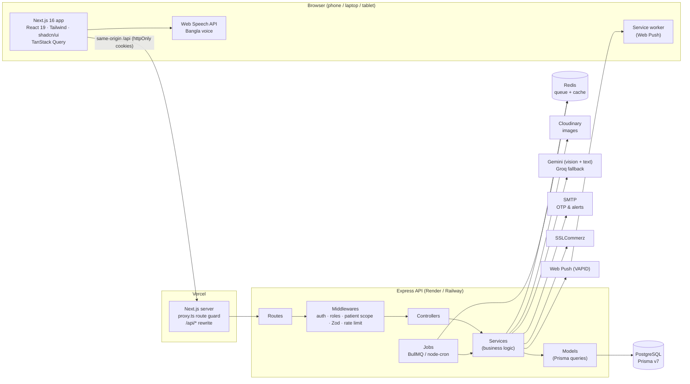
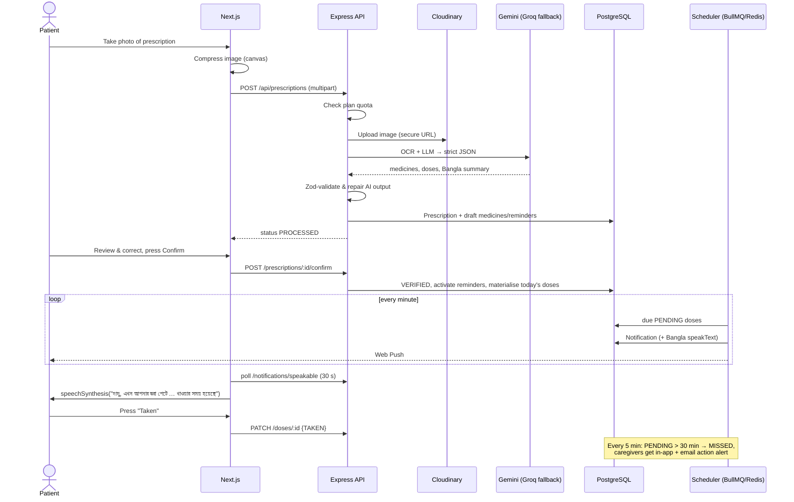

# SmartMed — System Architecture & SDA Workflow

## 1. High-level architecture



**Why the `/api` rewrite?** The browser only ever talks to the frontend origin, so the JWT cookies are
first-party `httpOnly` cookies — no CORS credentials or third-party-cookie issues in Safari/Chrome.

## 2. Backend MVC layering

| Layer | Folder | Responsibility |
| --- | --- | --- |
| Routes | `src/routes` | URL → middleware chain → controller |
| Middlewares | `src/middlewares` | JWT auth, role authorization, patient scope (self / caregiver / admin), Zod validation, uploads, rate limits, errors |
| **Controllers (C)** | `src/controllers` | Read the request, call a service, shape the HTTP response |
| Services | `src/services` | Business rules: scheduling, AI orchestration, quotas, payments, notifications |
| **Models (M)** | `src/models` + `prisma/schema.prisma` | All database queries, reusable selects |
| **Views (V)** | `src/views/emails` | Email templates; API responses use one JSON envelope |
| Jobs | `src/jobs` | Reminder dispatch, missed-dose alerts, expiry alerts, maintenance |
| Validators | `src/validators` | Zod schemas per feature |

Response envelope: `{ success, message, data, meta? }` · Errors: `{ success: false, message, code?, errors? }`.

## 3. Real-time data flow — prescription to voice reminder



## 4. Background jobs

| Job | Schedule (Asia/Dhaka) | What it does |
| --- | --- | --- |
| `materialize-doses` | hourly + on start | Creates today's `DoseLog` rows for every active reminder (idempotent) |
| `dispatch-reminders` | every minute | Notifies due doses: in-app, Web Push, Bangla voice line |
| `missed-doses` | every 5 min | Marks overdue doses MISSED, alerts patient + caregivers by email |
| `expiry-alerts` | hourly + on start | Cabinet items expiring within 7 days → alert patient & caregivers |
| `daily-maintenance` | 03:30 | Downgrade expired Premium, finish completed courses, purge old sessions/OTPs |

With `REDIS_URL`, BullMQ job schedulers guarantee each tick runs once across many API instances.
Without Redis, node-cron runs in-process (fine for a single instance). Jobs are idempotent, so a
sleeping free-tier server catches up when it wakes (and `/doses/today` materialises on demand).

## 5. Security

- Access JWT (15 min) + rotating refresh token (7 days, hashed) in httpOnly cookies; Bearer header also accepted for Postman
- Session table → logout per device, "log out other devices", admin force-logout, suspension revokes sessions
- Email OTP verification (bcrypt-hashed, 10 min, 5 attempts, 60 s resend cooldown) and OTP password reset
- Account lockout: 5 wrong passwords → 15 minutes
- Rate limiting (global, auth, AI), Helmet headers, Zod validation on every input, upload type/size limits
- Role-based authorization + patient-scope middleware (caregivers only see patients who accepted them)
- SSLCommerz payments validated server-to-server (amount + transaction id) and idempotent
- Secrets only in environment variables

## 6. AI features & graceful failure

| # | Feature | Endpoint |
| --- | --- | --- |
| 1 | Handwritten prescription OCR → structured medicines + Bangla summary | `POST /prescriptions` |
| 2 | Medicine-strip expiry / batch reader | `POST /cabinet/scan` |
| 3 | Plain-language medicine explainer (cached 7 days) | `POST /ai/medicine-info` |
| 4 | Drug-interaction, allergy and duplicate-therapy checker | `POST /ai/interactions` |
| 5 | Context-aware health assistant chat (knows current medicines) | `POST /ai/chat` |
| 6 | Adherence coach: analysis + tips for patient and family | `POST /ai/adherence-insight` |

Failure handling: Gemini → automatic Groq fallback → friendly 503. A failed prescription read keeps the
uploaded image with status `FAILED` so the patient can retry or type medicines manually. All AI JSON is
validated with Zod (`.catch()` repairs single bad fields). Every call is logged for monitoring.

## 7. Frontend structure (feature-based)

```
frontend/src
├── app/                    # Routes only (thin pages)
│   ├── (public)/           # Home, features, pricing, about
│   ├── (auth)/             # Login, register, verify email, forgot/reset password
│   ├── dashboard/          # Patient & caregiver app
│   ├── admin/              # Admin panel
│   └── share/[token]/      # Public read-only doctor view
├── features/<feature>/     # api.ts (React Query hooks) + feature components
│   ├── auth · profile · dashboard · prescriptions · medicines · doses
│   ├── cabinet · care · notifications · ai · billing · admin · marketing
├── components/ui           # shadcn/ui primitives
├── components/shared       # Empty/error/loading states, dialogs, pickers…
├── components/layout       # Site header/footer, dashboard shell, nav
├── lib/                    # API client, formatting, voice, push, image compression
├── providers/ · hooks/ · types/
└── proxy.ts                # Optimistic route protection
```
